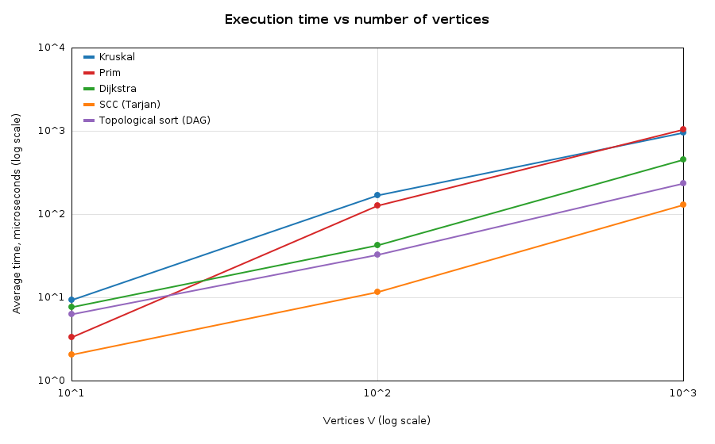
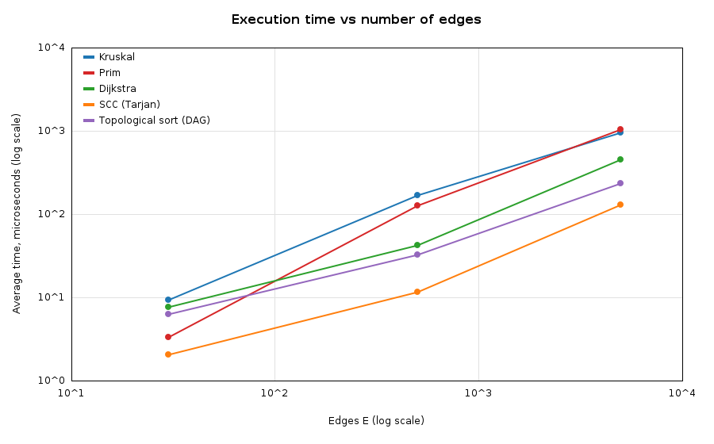
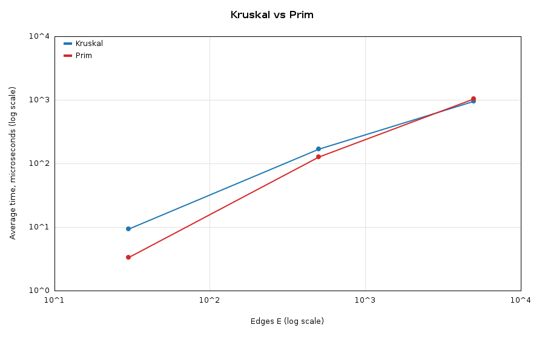
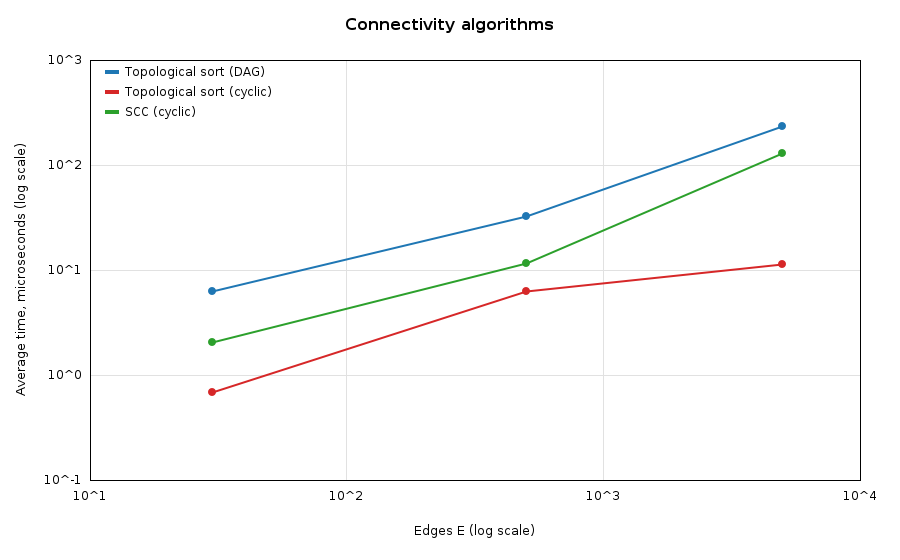

# Assignment 3 — Smart City Infrastructure and Route Planning

**Author:** Nurzhan Aisu, SE - 2530
**Language:** Java 17+ (no external libraries), IntelliJ IDEA project

## 1. Overview

The program models a smart city as a graph and solves three kinds of tasks:

| Task | Question | Algorithms |
|---|---|---|
| 1. Infrastructure planning | What is the cheapest road network that connects all districts? | Kruskal + DSU, Prim + priority queue |
| 2. Connectivity analysis | In which order can services be built? Which districts are mutually reachable on one-way roads? | Topological sort (Kahn), SCC (Tarjan) |
| 3. Route planning | What is the shortest route from one district to all others? | Dijkstra |

**Graph representation.** Vertices `0..n-1` are districts, edges are roads / dependencies, weights are construction costs or distances (integers 1..100).
The graph is stored as an **adjacency list** (`List<List<Edge>>`). In addition, a plain list of all edges is kept (each edge once) because Kruskal needs to sort the edges.
An undirected edge is stored in both adjacency lists; a directed edge only in the list of its start vertex.

### Project structure

```
assignment-3/
├── src/
│   ├── graph/         Edge, Graph, GraphGenerator
│   ├── dsu/           DSU
│   ├── mst/           Kruskal, Prim, MSTResult
│   ├── connectivity/  TopologicalSort, SCC
│   ├── shortestpath/  Dijkstra
│   ├── experiments/   Main (demo + all experiments), ChartUtil (PNG plots)
│   └── tests/         Tests (25 checks, no libraries needed)
├── results/
│   ├── tables/        CSV tables + all_tables.md
│   └── plots/         PNG plots
└── README.md
```

### How to run

IntelliJ IDEA: *File → New → Project from Existing Sources* → select the project folder → mark `src` as **Sources Root** → run `experiments.Main` (demo + experiments) or `tests.Tests` (tests).
The working directory must be the project root, so that `results/` is created there (this is the default).

Command line:

```
mkdir out
javac -d out $(find src -name "*.java")
java -cp out tests.Tests
java -cp out experiments.Main
```

## 2. Implementation

* **DSU** (`dsu/DSU.java`): arrays `parent[]` and `rank[]`. `find` is iterative with **path compression** (second pass points every vertex of the path to the root). `union` attaches the tree with the smaller rank under the bigger one (**union by rank**). The class has two flags to switch the optimizations off — this is used only in the DSU experiment. It also counts `find` calls, `union` calls and followed parent pointers.
* **Kruskal**: copy and sort all edges by weight (comparator counts comparisons), then take every edge whose endpoints are in different DSU sets. Stops early when `V-1` edges are chosen. `connected = (number of DSU components == 1)`.
* **Prim**: binary-heap `PriorityQueue<Edge>` with lazy deletion (an edge to an already visited vertex is simply skipped). If the graph is disconnected, Prim is restarted from every unvisited vertex, so both algorithms return a *minimum spanning forest* and the weights can still be compared.
* **Topological sort**: Kahn's algorithm (in-degrees + queue). If fewer than `V` vertices were removed, the graph contains a cycle and **no ordering exists** (`isDag = false`).
* **SCC**: Tarjan's algorithm (one DFS with `index`, `low` and a stack). Every vertex ends in exactly one component.
* **Dijkstra**: binary heap with lazy deletion. `dist[]` and `parent[]` give distances and paths; unreachable vertices keep `INF` and an empty path. A negative weight throws `IllegalArgumentException`.
* **Graph generator** (`GraphGenerator`, fixed seed `42`):
  * *Connected undirected graph*: first a random spanning tree (vertex `i` is joined to a random vertex `j < i`), which guarantees connectivity; then random extra edges are added (no self-loops, no duplicates) until `E` edges exist.
  * *Directed DAG*: random edges are always oriented from the smaller to the bigger index → **no cycles**.
  * *Directed cyclic graph*: random edges `(u, v)` in any direction, no self-loops, no duplicates → **contains cycles** (see Results for the SCC structure).

### Why Dijkstra does not work with negative edges

Dijkstra is greedy: when a vertex is taken from the queue with the smallest tentative distance, this distance is considered **final**. This is correct only because every other path to that vertex would have to pass through vertices that are not closer and could only add non-negative weights.
A negative edge breaks this. Example: `A→B (2)`, `A→C (5)`, `C→B (−4)`. Dijkstra finalizes `B = 2` first, but the real shortest path is `A→C→B = 1`. The finalized vertex would have to be updated again, which Dijkstra never does. For negative weights Bellman–Ford (`O(V·E)`) must be used (and a negative cycle makes shortest paths undefined). Our implementation rejects negative weights explicitly.

## 3. Complexity Analysis

Assumptions: graph stored as an adjacency list, `V` vertices, `E` edges, priority queue = binary heap (`O(log n)` push/poll), `α` is the inverse Ackermann function (≤ 4 for any practical input).

| Algorithm | Time | Extra space | How V and E affect it |
|---|---|---|---|
| DSU `find` / `union` (path compression + union by rank) | amortized `O(α(n))` per operation (≈ constant) | `O(V)` | Depends only on the number of elements; trees stay almost flat. Without both optimizations a single `find` can cost `O(V)` |
| Kruskal | `O(E log E) = O(E log V)` for sorting + `O(E·α(V))` for DSU | `O(V + E)` (sorted edge list + DSU) | Dominated by sorting, so grows with `E`; `V` matters only through DSU and the `V-1` stopping condition |
| Prim (heap) | `O(E log V)` | `O(V + E)` (heap can hold up to `E` entries) | Every edge is pushed/polled at most once per direction → grows with `E`; `log V` factor from the heap |
| Topological sort (Kahn) | `O(V + E)` | `O(V)` | Linear in both: every vertex and every edge is processed once |
| SCC (Tarjan) | `O(V + E)` | `O(V)` (+ recursion depth up to `V`) | Linear in both: one DFS |
| Dijkstra (heap, lazy deletion) | `O((V + E) log V)` | `O(V + E)` | Each edge can cause one push (`log` cost); each vertex is expanded once |

Notes:
* For Kruskal vs Prim: with a binary heap both are `O(E log V)`. Kruskal is simple and good for sparse graphs or when edges are already sorted; Prim does not need to sort all edges and is usually preferred for dense graphs (with an array-based `O(V²)` version it is optimal for very dense graphs, but we use the heap version).
* **Why the DSU optimizations help.** *Path compression* flattens the tree: after a `find`, every visited vertex points directly to the root, so later `find` calls are `O(1)`. *Union by rank* always hangs the shallower tree under the deeper one, so the tree height stays `O(log V)` even before compression. Together they give the amortized `O(α(n))` bound.

## 4. Experimental Setup

* **Graph sizes:** Small `V=10, E=30`; Medium `V=100, E=500`; Large `V=1000, E=5000`.
* **Undirected connected graphs** (Kruskal, Prim, Dijkstra): `GraphGenerator.connectedUndirected(V, E, 42)`, weights 1..100. Dijkstra starts from vertex `0`.
* **Directed graphs** (topological sort, SCC): `GraphGenerator.directed(V, E, dag, 42)`. Two variants for each size: a **DAG** (edges go from smaller to bigger index) and a **cyclic** graph (random direction, cycles appear).
* **Measurement:** `System.nanoTime()`. For every algorithm and graph size: 300 warm-up executions (not measured, lets the JIT compile the code), then the experiment is **repeated 5 times**; one repetition times a batch of 50 executions and divides by 50 (a single run takes only microseconds, which is too short for a precise single timer reading). The reported time is the **average of the 5 repetitions** in microseconds (µs).
* **Operation counts** (deterministic, do not depend on the machine): edge examinations, sorting comparisons (Kruskal), DSU operations = `find` + `union` calls, priority-queue operations = push + poll (Prim, Dijkstra), edge relaxations (Dijkstra).
* Everything is reproducible: same seed → same graphs → same operation counts. Absolute times depend on the computer and change slightly from run to run.

## 5. Results

Raw tables are in `results/tables/` (CSV and `all_tables.md`), plots in `results/plots/`.

### 5.1 Kruskal vs Prim (undirected, connected graphs)

| Graph | Algorithm | Avg time (µs) | Edges examined | Sort comparisons | DSU ops (find+union) | PQ ops (push+poll) | MST weight | Connected |
|---|---|---|---|---|---|---|---|---|
| Small | Kruskal | 9.47 | 14 | 107 | 42 | - | 129 | true |
| Small | Prim | 3.37 | 30 | - | - | 60 | 129 | true |
| Medium | Kruskal | 171.52 | 164 | 3827 | 492 | - | 1170 | true |
| Medium | Prim | 128.59 | 500 | - | - | 1000 | 1170 | true |
| Large | Kruskal | 975.83 | 3356 | 50369 | 10068 | - | 13123 | true |
| Large | Prim | 1045.16 | 5000 | - | - | 10000 | 13123 | true |

Both algorithms return **the same MST weight** on every graph.

### 5.2 DSU optimizations (Large graph: union all 5000 edges in weight order, then `find` every vertex)

| Variant | find calls | union calls | Parent pointers followed | Avg steps per find |
|---|---|---|---|---|
| No optimization | 11000 | 5000 | 1071576 | 97.42 |
| Path compression only | 11000 | 5000 | 16282 | 1.48 |
| Union by rank only | 11000 | 5000 | 20406 | 1.86 |
| Both (used in project) | 11000 | 5000 | 10526 | 0.96 |

### 5.3 Topological sort (DAG and cyclic graphs)

| Graph | Input | Avg time (µs) | Edges examined | Is DAG | Vertices in order |
|---|---|---|---|---|---|
| Small | DAG | 6.36 | 60 | true | 10/10 |
| Small | Cyclic | 0.70 | 30 | false | 0/10 |
| Medium | DAG | 32.71 | 1000 | true | 100/100 |
| Medium | Cyclic | 6.35 | 500 | false | 0/100 |
| Large | DAG | 237.96 | 10000 | true | 1000/1000 |
| Large | Cyclic | 11.49 | 5054 | false | 10/1000 |

### 5.4 Strongly connected components (Tarjan)

| Graph | Input | Avg time (µs) | Edges examined | SCC count | Largest SCC |
|---|---|---|---|---|---|
| Small | Cyclic | 2.08 | 30 | 1 | 10 |
| Small | DAG | 1.38 | 30 | 10 | 1 |
| Medium | Cyclic | 11.67 | 500 | 1 | 100 |
| Medium | DAG | 12.33 | 500 | 100 | 1 |
| Large | Cyclic | 132.84 | 5000 | 18 | 983 |
| Large | DAG | 48.41 | 5000 | 1000 | 1 |

The random cyclic graphs contain cycles: for Small and Medium the whole graph is one SCC; for Large there is one giant SCC with 983 vertices and 17 single-vertex components.

### 5.5 Dijkstra (source = vertex 0)

| Graph | Avg time (µs) | Edge relaxations | PQ ops | Reachable |
|---|---|---|---|---|
| Small | 7.83 | 60 | 36 | 10/10 |
| Medium | 43.42 | 1000 | 400 | 100/100 |
| Large | 458.87 | 10000 | 3974 | 1000/1000 |

### 5.6 Plots

Execution time vs number of vertices:



Execution time vs number of edges:



Additional plots:




Both axes use a logarithmic scale. Because the three configurations increase `V` and `E` together (`E = 3V…5V`), the "time vs V" and "time vs E" plots look similar.

## 6. Comparison and Discussion

**Kruskal vs Prim.** Both give identical MST weights (129, 1170, 13123). Their running times are close: Prim is faster on the Small and Medium graphs, and on the Large graph the times are practically equal (976 µs vs 1045 µs; the difference is within the measurement noise). The operation counts show the different work: Kruskal does ~`E log₂E` sorting comparisons (50 369 for `E = 5000`, theory ≈ 61 000) and ~2 DSU operations per examined edge, but it **stops early** after `V-1` tree edges — it examined only 3356 of 5000 edges. Prim examines all 5000 edges and does `2E = 10 000` heap operations. This matches the theory: both are `O(E log V)`; the winner depends on the constants and the graph density, not on the asymptotics.

**DSU.** Without optimizations a `find` follows on average 97 parent pointers on the Large graph (the trees degenerate into long chains). Path compression alone reduces this to 1.48, union by rank alone to 1.86, both together to 0.96 — about **100× fewer steps**. This confirms the amortized `O(α(n))` bound: the cost of DSU in Kruskal is almost constant per edge, and the sorting dominates.

**Topological sort.** On DAGs the algorithm processes every edge twice (once to count in-degrees, once during removal): `2E` edge examinations (60, 1000, 10000), so it is linear. On cyclic graphs it correctly reports `isDag = false`. Here it is much faster, because it stops quickly: in these random graphs almost every vertex has an incoming edge, so the queue is empty at the start (0 vertices sorted for Small and Medium, 10 for Large). The time on cyclic graphs is therefore not comparable with the DAG time.

**SCC.** The number of examined edges is exactly `E` (30, 500, 5000), i.e. every edge is examined once — `O(V+E)`. Time grows from 2 µs to 12 µs to 133 µs when the graph is 10× bigger each step (≈ 6× then ≈ 11×), which is roughly linear; the second step is a bit above 10× because of cache effects and the deeper DFS recursion in the large graph with a giant component. On a DAG every vertex is a separate SCC (`V` components), which is consistent with the topological sort test.

**Dijkstra.** The number of edge relaxations is `2E` (every undirected edge is stored twice): 60, 1000, 10 000. Heap operations are far fewer than `E` (3974 for Large) because a vertex is pushed again only when a *shorter* distance is found. Time grows from 8 µs to 43 µs to 459 µs, i.e. a bit faster than linear, as expected from `O((V+E) log V)`.

**Theory vs experiment.** In all experiments the operation counts match the theoretical formulas well. The times grow roughly proportionally to `E` (or `E log E`), but at these small sizes the measured times are affected by JIT compilation, garbage collection and cache effects, so only the general trend is reliable, not the exact ratio between two close algorithms.

## 7. Testing

Run `tests.Tests` (plain Java, no JUnit needed): **25 checks, all passed** (`results/test_output.txt`).

| Area | Test cases |
|---|---|
| MST | small graph with known answer (6); disconnected graph (3 components, forest weight 3, detected by both algorithms); graph with a cycle (triangle); graph with multiple valid MSTs (square, all weights 1); duplicate weights (K4, all weights 5 → 15); single vertex (weight 0, connected); **200 random connected graphs: Kruskal weight == Prim weight and exactly `V-1` edges** |
| Topological sort | small DAG → order is valid (every edge goes forward); cycle `0→1→2→0` is detected; single vertex; **100 random DAGs: order valid every time**; 100 random cyclic graphs: "has a cycle" answer agrees with SCC (a graph is a DAG ⇔ all SCCs have size 1) |
| SCC | two cycles joined by one edge → exactly `{0,1,2}` and `{3,4,5}`; single vertex; DAG → `V` components; **100 random graphs: every vertex is in exactly one SCC** |
| Dijkstra | small graph with known distances and path; **unreachable vertex** (distance `INF`, empty path); single vertex; negative weight is rejected; **100 random directed graphs compared with Floyd–Warshall** (including unreachable vertices) |

## 8. Conclusion

* **MST:** Kruskal and Prim always find the same minimum cost. Kruskal (with DSU) is simple and works directly on an edge list; it can stop early. Prim is natural when the graph is already an adjacency list and is the better choice for dense graphs. For the sparse city-road graphs in this assignment both are fast (≈ 1 ms for 1000 districts).
* **DSU:** path compression and union by rank are cheap to implement and reduce the work by about two orders of magnitude; they should always be used.
* **Connectivity:** topological sort (Kahn) both orders the tasks of a DAG and detects dependency cycles; Tarjan's SCC finds groups of mutually reachable districts. Both are linear `O(V+E)` and scale well.
* **Shortest paths:** Dijkstra with a binary heap is the right tool for road networks with non-negative distances (`O((V+E) log V)`); for negative weights Bellman–Ford is required.
